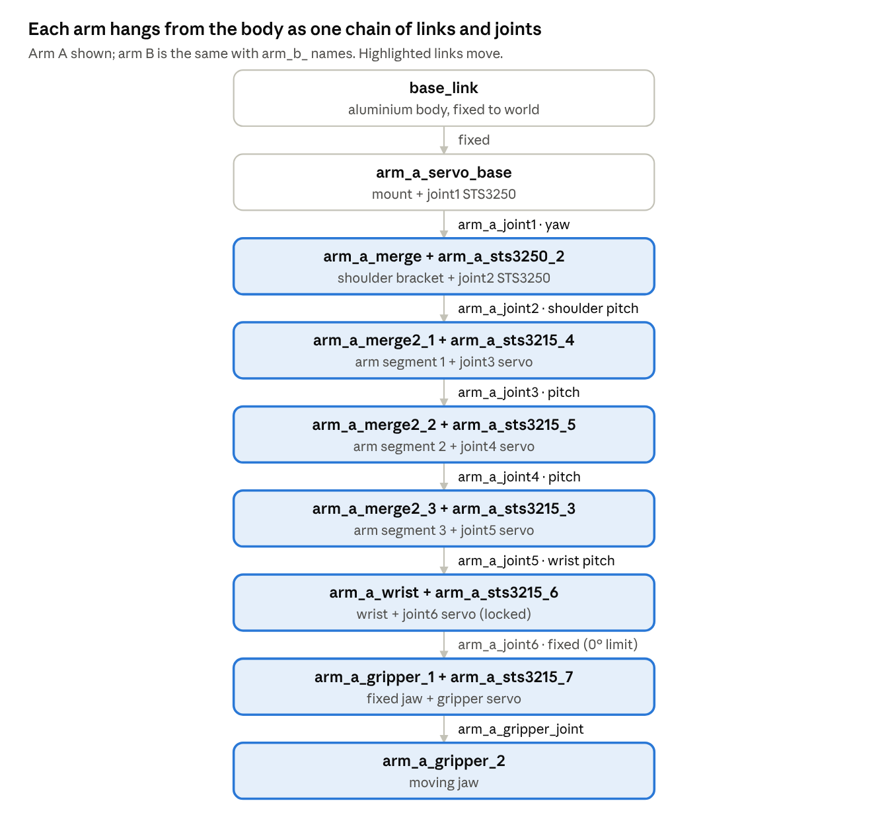

# Arm + Body: ROS 2 Jazzy description package

Dual-arm robot (two 6-DOF arms + grippers on an aluminium-extrusion body), generated from the Fusion design **Arm + Body v15**. Runs in RViz and in Gazebo Harmonic with ros2_control on **Ubuntu 24.04 / ROS 2 Jazzy**.



## Quick start
```bash
mkdir -p ~/arm_body_ws/src && cd ~/arm_body_ws/src
git clone https://github.com/Aqid2108/arm-body-ros2.git
cd ~/arm_body_ws
rosdep install --from-paths src -y --ignore-src
colcon build --symlink-install
source install/setup.bash

ros2 launch arm_body_description display.launch.py   # RViz + joint sliders
ros2 launch arm_body_description gazebo.launch.py    # Gazebo + ros2_control
```

Full setup, commands and joint reference: **[docs/RUN_GUIDE.md](docs/RUN_GUIDE.md)**.

## Contents
| Path | What |
|---|---|
| `arm_body_description/` | ROS 2 package: URDF/xacro, meshes, controllers, launch files |
| `docs/RUN_GUIDE.md` | Install, build, RViz, Gazebo, joint/controller reference, troubleshooting |
| `arm_body_moveit_config/` | MoveIt 2 configuration: mock demo and MoveIt on Gazebo ([README](arm_body_moveit_config/README.md)) |
| `arm_motion_demos/` | Gesture demos (wave, dual-arm, 67 dance), sequences, tests, video recording ([README](arm_motion_demos/README.md)) |

## Key facts
- 30 links, 14 controllable joints (6 per arm + 1 gripper per arm), 6.82 kg total
- Shoulder servos: Feetech STS3250 (12 V); all others STS3215 (12 V)
- Arm B mirrors arm A: send the same joint values for mirror-image motion
- Self-collision is optional: `gazebo.launch.py self_collide:=true`
