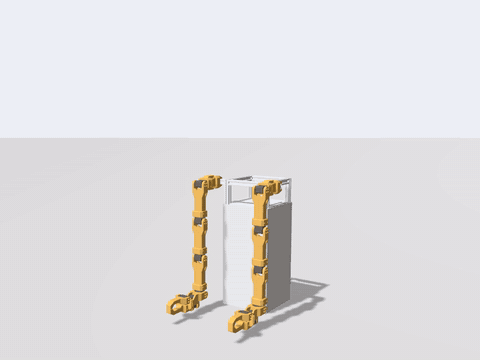

# arm_motion_demos

Gesture demonstrations for the dual-arm robot, in simulation (MoveIt mock demo or Gazebo):

| Gesture | What it does |
|---|---|
| `wave` | One arm swings out to the side, forearm up, gripper open; the hand sways ~20 cm side to side |
| `dual_arm` | Both arms forward → raised together → alternating up/down → out to the sides → symmetric flaps |
| `dance67` | "6-7": forearms forward, palms (grippers) open, hands bobbing up and down in turn; the wrists counter-rotate so the palms stay level |

| Wave | Dual-arm routine (1.5x) | 67 dance |
|:---:|:---:|:---:|
|  |  |  |

Every gesture starts and ends at the SRDF `home` pose, so gestures can be chained in any order.
The gestures are YAML files in [`motions/`](motions) (the motion library, see
[Adding a motion](#adding-a-motion)); `motion_demo` and the arm motion player both read them.
The original `arm_motion_node` (home → raised → home over the trajectory topics) is unchanged.

## Run
Start a simulation first, in a terminal with the same `ROS_DOMAIN_ID` as below:
```bash
source /opt/ros/jazzy/setup.bash
source ~/moretea_arm_body_ws/install/setup.bash
export ROS_DOMAIN_ID=215 ROS_AUTOMATIC_DISCOVERY_RANGE=LOCALHOST GZ_IP=127.0.0.1
export GZ_PARTITION=moretea_215

ros2 launch arm_body_moveit_config moveit_gazebo.launch.py   # Gazebo + MoveIt + RViz
# or, without physics:
ros2 launch arm_body_moveit_config demo.launch.py            # mock hardware + MoveIt + RViz
```
Then, in a second terminal with the same exports:
```bash
ros2 run arm_motion_demos motion_demo                                        # wave, dual_arm, dance67
ros2 run arm_motion_demos motion_demo --ros-args -p "sequence:=[wave]"
ros2 run arm_motion_demos motion_demo --ros-args -p "sequence:=[wave]" -p wave_arm:=arm_b
ros2 run arm_motion_demos motion_demo --ros-args -p "sequence:=[dual_arm]"
ros2 run arm_motion_demos motion_demo --ros-args -p "sequence:=[dance67]" -p dance_tempo:=40.0 -p dance_amplitude:=0.3
ros2 run arm_motion_demos motion_demo --ros-args -p "sequence:=[home, wave, dual_arm, dance67, home]"
ros2 run arm_motion_demos motion_demo --ros-args -p dry_run:=true            # check only, no motion
```
Don't press **Plan & Execute** in RViz while a demo runs: both would command the same
controllers. motion_demo notices (the arms leave its plan) and stops, but avoid it.

### Parameters
| Parameter | Default | Meaning |
|---|---|---|
| `sequence` | `[wave, dual_arm, dance67]` | Gestures in order; `home` entries are allowed. The robot is homed first if needed |
| `speed` | `1.0` | Scales every move and oscillation (0.1–3; refused if it breaks a limit, in practice above ~1.1) |
| `repetitions` | `0` | Waves / raises / dance cycles; `0` = each gesture's default (3 / 2 / 6) |
| `wave_arm` | `arm_a` | `arm_a` (robot's left) or `arm_b` |
| `dance_tempo` | `54.0` | Beats per minute of sim time; one beat = one hand up. Max ~55 at amplitude 0.25 |
| `dance_amplitude` | `0.25` | Forearm tilt in rad (0.05–0.3); larger amplitudes need a slower tempo |
| `collision_check` | `true` | Check every state with MoveIt's `/check_state_validity` before moving |
| `dry_run` | `false` | Build and check everything, don't move |
| `tracking_tolerance` | `0.2` | Stop if a joint is further than this (rad) from the plan |
| `motion_folders` | `['']` | Extra folders of `*.yaml` motions, besides the package's `motions/` |

Exit codes: `0` done, `1` stopped while moving, `2` refused before moving, `130` Ctrl-C.

## Safety
Before anything moves, motion_demo:
1. builds every gesture from the SRDF `home` and samples it every 10 ms;
2. refuses it unless all positions stay **0.01 rad inside the URDF limits** (home sits exactly
   there for the limits at 0, which jam in Gazebo when held), velocities are within the URDF
   limits and accelerations within MoveIt's `joint_limits.yaml`;
3. checks a state every 0.1 s for collisions in MoveIt's planning scene (self-collision, and
   Gazebo's floor when started from `moveit_gazebo.launch.py`).

While moving, it compares `/joint_states` with the plan. It brings all controllers to a stop
and holds (a one-point trajectory at the current position plus the stopping distance,
decelerating within the acceleration limits) if a joint leaves the plan by more than
`tracking_tolerance`, comes within 3 mrad of a URDF limit, `/joint_states` stops, or on Ctrl-C.
(The controllers reject an empty trajectory, so that cannot be used to stop them.)
Afterwards, `-p "sequence:=[home]"` brings the robot back to home.

The gestures were designed with forward kinematics on the collision meshes: they keep
≥ 1.5 cm from the floor (home itself hangs ~2 cm above it), ≥ 2 cm from the body and ≥ 5 cm
between the arms. **Simulation only:** these trajectories have not been run on the real servos.

## Tests
```bash
colcon test --packages-select arm_motion_demos && colcon test-result --verbose  # offline, no robot
ros2 run arm_motion_demos check_motion_demos     # live, against a running mock or Gazebo
```
- Offline (`test/test_motions.py`): limits, home, each gesture's shape (one arm waves, arms
  in/out of phase, dance tempo/amplitude), sequences, invalid parameters, the validator, and
  floor/body/arm clearance with forward kinematics on the collision meshes (`test/geometry.py`).
- Live (`check_motion_demos`): runs motion_demo for each scenario and checks the joint
  positions the robot reports: dry run, invalid parameters (refused, nothing moves), every
  gesture and the full sequence (limits, motion, back home), Ctrl-C mid-dance (arms stop,
  then go home), a conflicting controller command mid-wave (detected, stopped), and an obstacle
  in the wave's path (refused by the collision check). `--quick` runs one repetition each.

## Recording a video
`worlds/demo_recording.sdf` is Gazebo's empty world plus a fixed camera that films the robot
from the front at three-quarter view. `record_demo` writes that camera to an MP4 file. The
camera produces 30 frames per second of *sim* time, so videos play at the true tempo even
when Gazebo runs slower than real time.
```bash
W=$(ros2 pkg prefix arm_motion_demos)/share/arm_motion_demos/worlds/demo_recording.sdf
ros2 launch arm_body_moveit_config moveit_gazebo.launch.py world:="$W"            # with GUI
# or headless:  world:="-s --headless-rendering $W" rviz:=false

# second terminal (same exports): start recording; press Ctrl-C here when the demo has finished
ros2 run arm_motion_demos record_demo ~/demo_full.mp4      # or --duration 75 to stop by itself

# third terminal (same exports): run the demo
ros2 run arm_motion_demos motion_demo --ros-args -p "sequence:=[home, wave, dual_arm, dance67, home]"
```
Clips per gesture: replace the sequence with `[wave]`, `[dual_arm]` or `[dance67]`.
To capture RViz or the Gazebo GUI window instead, use a screen recorder (on Ubuntu's GNOME:
Ctrl+Shift+Alt+R, or the screenshot tool's video mode); those play at the simulation's speed
(~0.6× real time here).

## Known limitations
- MoveIt's acceleration limits (3.0 rad/s², placeholders until the servos are characterised)
  keep the gestures calm: e.g. the dance tops out at ~55 bpm at amplitude 0.25.
- In Gazebo the arms lag the plan by up to ~0.1 rad at peak speed (position-controller
  tracking); the stop threshold is 0.2 rad.
- The collision check uses MoveIt's allowed-collision matrix (sampled, see the SRDF); the
  offline FK test covers floor, body and arm-to-arm distances independently.
- Topic commands from other tools (e.g. `arm_motion_node`) bypass these checks.

## Adding a motion
Each `*.yaml` file in `motions/` (or in a `motion_folders` folder) is one motion; its `name`
is what goes in `sequence`. The format is documented at the top of
[`motion_library.py`](arm_motion_demos/motion_library.py); `motions/wave.yaml` is the
simplest example:
```yaml
name: wave
title: Wave
description: One arm out to the side, forearm up, hand swaying side to side.
parameters:
  repetitions: {type: int, default: 3, min: 1, max: 20, help: number of waves}
  arm: {type: choice, default: arm_a, choices: [arm_a, arm_b], help: which arm waves}
poses:                      # home plus these joints (rad); joint1..joint6 per arm
  hand_up:
    "{arm}": [1.3, -1.57, -1.2, -0.3, 1.57, 0.01]
    "{arm}_gripper_joint": 0.6
steps:
  - move: hand_up
    label: "{arm}: raise hand"
  - oscillate:
      amplitude: {"{arm}": [0.0, 0.0, 0.25, 0.2, 0.25, 0.0]}
      cycles: repetitions
    label: "{arm}: wave x{repetitions}"
  - move: home
    label: back to home
```
Steps are `move` (to a pose), `oscillate` (sway around the current pose), `hold` and
`repeat`. Numbers can be expressions of the parameters (`2 * 60 / tempo`). A motion must end
at home and pass every check above; a file that does not is skipped with the reason (and
`motion_demo` says so). Run `colcon build` after editing the files in `motions/`.
The YAML files reproduce the earlier Python gestures sample for sample
(`test/test_motion_library.py` compares them with a frozen copy, `test/legacy_gestures.py`).

